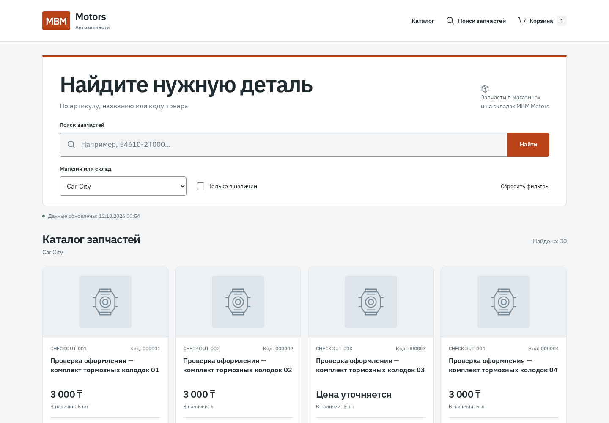
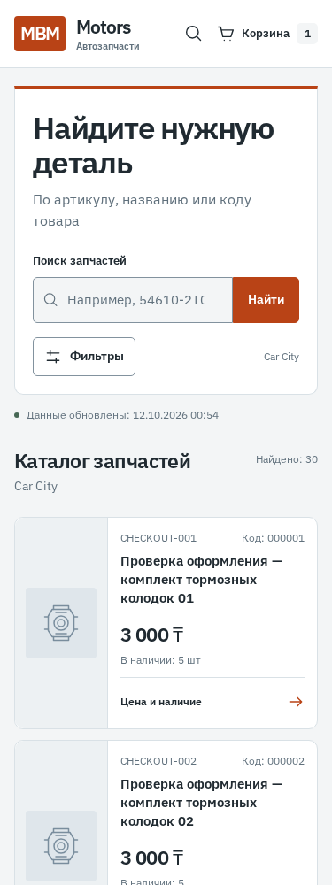

# Дизайн магазина MBM Motors

## Направление

Светлый специализированный магазин с ясной типографикой и оранжевым поисковым блоком. Главная задача — найти деталь, проверить артикул, цену и наличие, добавить в корзину и сохранить заявку. Промпт пользователя от 12.10.2026 принят как ориентир дальнейшей frontend-разработки: собственный характер, спокойное окружение, реальные данные и проверенный сценарий покупки.

Сохранены React, TypeScript, Vite, Tailwind CSS 4, React Query и клиентский рендеринг. Новых зависимостей нет. IBM Plex Sans 400/600 с кириллицей поставляется локально. API и backend не менялись.

## Дизайн-токены

| Роль | Цвет |
| --- | --- |
| Фон | `#F3F5F6` |
| Поверхность | `#FFFFFF` |
| Основной текст | `#202A31` |
| Вторичный текст | `#61717D` |
| Границы | `#D9E1E6` |
| Основные действия | `#B94316` |

Токены и стили находятся в `frontend/src/styles/theme.css`. Ширина контента — 1240px. Основные отступы кратны 4px; элементы управления от 44px. Скругления контролов — 5px, товарных блоков — 10px. Финансовые значения используют tabular-nums. Общие иконки — собственные SVG в `shared/ui/Icon.tsx`.

Выразительный элемент — поисковый блок с акцентной верхней границей и крупным заголовком. Остальные поверхности спокойные. Декоративных градиентов, стеклянных эффектов и массовых анимаций нет.

## Страницы

- Шапка: каталог, поиск и корзина со счётчиком. На главной поиск ведёт к основному полю; на остальных страницах работает поисковая форма.
- Каталог: четыре колонки на широком экране, три/две на промежуточных ширинах, компактные строки на телефоне. Фото имеют согласованную область и существующую заглушку. Карточка ведёт к цене и наличию; добавление выполняется на странице товара после проверки доступности.
- Мобильные фильтры: нативный dialog на ширинах до 639px. Значения применяются сразу и сохраняются в URL. Escape закрывает панель, фокус возвращается к триггеру; при переходе к широкому экрану — к выбору магазина. Ошибку загрузки магазинов можно повторить внутри панели.
- Товар: изображение, название, характеристики и панель цен по точкам. На телефоне панель покупки идёт перед характеристиками, чтобы не прятать действие далеко внизу.
- Корзина: читаемые позиции, артикул, цена за единицу, количество и сумма. Удаление и очистка требуют подтверждения; обновление цены и недоступные позиции сохранены.
- Оформление: единые поля контактов, итог и пояснение локального статуса заявки. Восстановление после неопределённой отправки сохранено. Результат не обещает подтверждение магазином, резерв или оплату.

Категории, сортировка, бренды и совместимость не добавлены: этих данных или возможностей нет в текущем API. Отзывы, скидки, сроки выдачи и гарантии не выдумывались.

## Проверка

Браузерные проверки выполнялись в Chromium на синтетической `mbm_test:5433`, backend8082 и Vite5174. Рабочая БД5432, сайт8081 и CloudShop не изменялись.

- Каталог: 10 групп — поиск/URL, фильтры, пагинация, пустая выдача, ошибки, устаревшие данные и клавиатура.
- Товар и корзина: 6 групп — добавление, количество, CSRF, отдельные сессии, подтверждения, удаление и ошибки.
- Оформление: 8 групп — ошибки полей, размеры экрана, один POST при двойном submit, потеря ответа, ручной повтор и восстановление сессии. Создавались только синтетические локальные заявки.
- `check_storefront_design.py`: панель фильтров, Escape, фокус, resize, ошибка магазинов, поиск в шапке, reduced motion и четыре страницы на 375/768/1440px. Горизонтального переполнения и JS-ошибок нет.
- Скриншоты просмотрены: исправлены высота поиска, положение мобильного блока покупки и специфичность hover основного действия.

Frontend build и release verify успешны: 96 Java-тестов, 95 успешны, 1 Docker-вариант пропущен; реальные PostgreSQL-тесты выполнены. Python26 успешных. Окончательный JAR отдельно прошёл каталог, оформление и новую визуальную проверку. Результаты сохранения указаны в начале `PROJECT_CONTEXT.md`. Проверки Chromium не заменяют отдельную проверку Safari/iOS и Android на физических устройствах.

## Превью

Данные на скриншотах синтетические, фотографии заменены заглушками.

